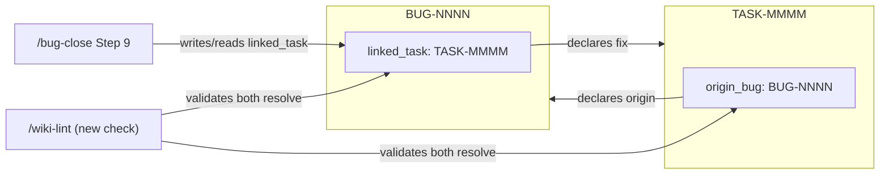
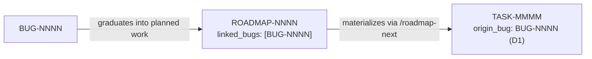
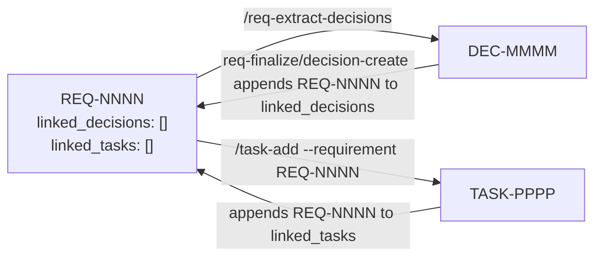
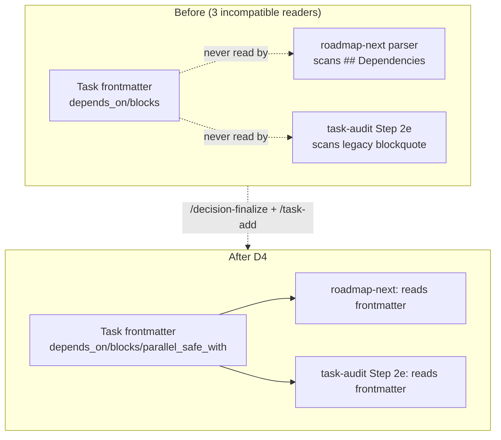

# DEC-0001: Wiki Cross-Family Linking Schema

> Decision Group covering bug↔task linking, roadmap↔bug linking, requirement↔decision/task linking, and task-dependency-encoding reconciliation.

- **File created**: 2026-09-13
- **Last updated**: 2026-09-18
- **Tags (group)**: wiki-schema, cross-family-linking, sdlc-synergy

## Shared Context

`raw/research/wiki-work-family-synergy/index.md` (ingested as `wiki/knowledge/sources/wiki-work-family-synergy.md` and `wiki/knowledge/concepts/wiki-work-family-cross-linking-gaps.md`) audited this repo's own `wiki/work/` six-family lifecycle schemas (`requirements`, `decisions`, `roadmaps`, `tasks`, `uat`, `bugs`) for cross-family linking mechanisms. It found three family-pairs with **no schema-level link field in either direction** (bug↔task, roadmap↔bug, requirement↔decision/task) and, on closer inspection while drafting this decision, **three mutually incompatible task-dependency encodings** already live in this repo simultaneously: `wiki/work/tasks/lifecycle.md`'s documented frontmatter arrays (`depends_on`/`blocks`/`parallel_safe_with`), `lib/skills/roadmap-next/SKILL.md`'s shared "Parse a roadmap" procedure which scans body headings (`## Dependencies`/`## Blocked by`), and `lib/skills/task-audit/SKILL.md` Step 2e's legacy blockquote parser (`> **Depends on**: [002-foo](002-foo.md)`, still using pre-wiki2, pre-`TASK-`-prefix slug links). Sampled real tasks (`TASK-0085`, `TASK-039`) populate only the frontmatter arrays — the other two parsers currently find nothing in any live file.

**Critical constraint on every decision below**: this repository is the **template source** for the `@codewizard-dt/bootstrap` pattern. The six `wiki/work/<family>/lifecycle.md` files under `wiki/work/` here are always-refreshed copies of `lib/scripts/templates/wiki/work/<family>/lifecycle.md`, delivered to every downstream project by `sync-wiki-scaffold.sh`. Any schema change accepted here must be implemented in the **template copy** (`lib/scripts/templates/wiki/work/<family>/lifecycle.md`), not only the local `wiki/work/<family>/lifecycle.md`, or it is invisible to every project that runs `bootstrap update` and is silently overwritten in this repo on the next scaffold sync. New fields must stay **optional and declared-not-backfilled**, per `wiki/conventions.md`'s existing typed-link philosophy, so the 85+ existing task files and dozens of bug/UAT files that predate this decision are never broken.

None of these four decisions supersedes an existing decision — `wiki/work/decisions/` is empty prior to this file (confirmed via `list_dir` on both `wiki/work/decisions/` and `archive/` immediately before writing).

---

## D1. Formalize Bug↔Task Linking as `linked_task`/`origin_bug` Frontmatter Fields

- **Status**: accepted
- **Date**: 2026-09-18
- **Deciders**: David Taylor
- **Supersedes**: none
- **Tags**: bug-schema, task-schema, cross-linking

### Context (decision-specific)

`wiki/work/bugs/lifecycle.md`'s frontmatter schema table defines no field linking a bug to the task that fixes it, or vice versa. In practice, `wiki/work/bugs/BUG-0008-hook-audit-cleanup-checklist.md` already carries an undocumented `linked_task:` frontmatter key plus an ad hoc `## Related` prose section with untyped `[[TASK-039]]` wikilinks — the schema drifted behind real usage rather than the reverse. `/bug-close`'s Step 9 currently only appends free text ("Closes BUG-NNNN") to the task footer when a linked task is supplied by hand; there is no structured field either skill can read or write reliably.

### Decision Drivers

| # | Driver | Why it matters |
|---|--------|----------------|
| 1 | Zero-migration compatibility | `BUG-0008` already uses `linked_task:` in production; renaming it is pure churn with no functional benefit |
| 2 | Machine-readability | `/wiki-lint`, `/bug-close`, and `/task-audit` read frontmatter directly; typed body links are not parsed by any tool today (per `relates_to::[[typed-wiki-links]]`) |
| 3 | Symmetry with existing precedent | `UAT` already has a required singular `task:` back-link field for its strict 1:1 relationship with a task — bug→task is the same shape (a bug is normally fixed by one task) |
| 4 | Optional, declared-not-backfilled | Must not force every existing bug/task file to gain the field immediately |

### Considered Options

| Option | One-line summary (≤15 words) |
|--------|------------------|
| **A. Formalize `linked_task`/`origin_bug`** | Keep `BUG-0008`'s exact field name; add a symmetric singular field on tasks |
| **B. Pluralize to `fixed_by`/`origin_bug` arrays** | Rename to array style matching `depends_on`/`linked_requirements` pluralization |
| **C. Typed body links only** | `fixed_by::[[TASK-NNNN]]` as a body line, no frontmatter change |

### Option Comparison

| Criterion | Option A | Option B | Option C |
|-----------|----------|----------|----------|
| Matches existing real data (`BUG-0008`) | ✅ | ⚠️ (requires rename) | ⚠️ (would coexist with existing frontmatter key) |
| Machine-readable by `/wiki-lint`/`/bug-close` today | ✅ | ✅ | ❌ |
| Handles rare multi-task-fixes-one-bug case | ⚠️ (single value) | ✅ | ✅ |
| Migration cost | None | Low (1 file) | None, but leaves `linked_task:` orphaned |
| Consistency with array-style siblings (`depends_on`, `linked_requirements`) | ⚠️ | ✅ | — |

### Trade-off Detail per Option

#### Option A: Formalize `linked_task`/`origin_bug`
| Aspect | Assessment |
|--------|------------|
| Pros | Zero migration; matches the one real precedent exactly; simple singular field mirrors UAT's `task:` pattern |
| Cons | Doesn't cleanly express the rare case of one bug needing multiple fix tasks |
| Risks | Low — if a multi-task fix is ever needed, the field can be widened to accept a list later without breaking single-value readers |
| Exit cost | Low — a future widen-to-array migration touches at most a handful of files |

#### Option B: Pluralize to `fixed_by`/`origin_bug` arrays
| Aspect | Assessment |
|--------|------------|
| Pros | Consistent pluralization with `depends_on`/`blocks`/`linked_requirements`/`linked_decisions`; handles multi-task fixes naturally |
| Cons | Requires migrating `BUG-0008`'s existing `linked_task:` key — the one piece of real data this decision is trying to formalize, not replace |
| Risks | A rename this early (before the field is even declared in the schema) is low-risk, but still unnecessary churn for a single file |
| Exit cost | Low |

#### Option C: Typed body links only
| Aspect | Assessment |
|--------|------------|
| Pros | Zero schema change; consistent with the wiki's declared `rel::[[target]]` vocabulary |
| Cons | Not machine-readable by any current tool (confirmed by `wiki/knowledge/concepts/typed-wiki-links.md`: "not queried... by any tool"); leaves `BUG-0008`'s existing frontmatter key undocumented and orphaned |
| Risks | Directly reproduces the exact problem this decision exists to fix — schema and practice diverging |
| Exit cost | High — would need to migrate to frontmatter later anyway once any tool needs to read the link |

### Decision Outcome

**Chosen option**: **A — Formalize `linked_task`/`origin_bug`**, because it costs zero migration, matches the one piece of real production data (`BUG-0008`) exactly, and keeps the field machine-readable for `/wiki-lint` and `/bug-close`.

### Decision Flow

### Consequences

| Type | Consequence |
|------|-------------|
| ✅ Positive | `/bug-close` can auto-populate the fix-commit/task link instead of relying on free text; `/task-audit`/`/bug-assess` can surface "bug-driven" work distinctly from planned work |
| ⚠️ Negative | Existing bugs/tasks predating this decision have no `linked_task`/`origin_bug` value — must be treated as absent, not an error |
| 🔁 Follow-up | Add `linked_task` (optional) to `bugs/lifecycle.md`'s schema table and `origin_bug` (optional) to `tasks/lifecycle.md`'s, in **both** the local `wiki/work/` copies and the `lib/scripts/templates/wiki/work/` originals; update `/bug-close` Step 9 to write `linked_task`/`origin_bug` instead of only prose; update `/bug-triage` to offer setting `origin_bug` when it spawns a fix task |

### Validation

| Signal | Threshold | When measured |
|--------|-----------|---------------|
| New bugs closed via `/bug-close` carry a structured `linked_task` | ≥90% of bugs closed after this lands | 60 days post-`/decision-finalize` |
| `/wiki-lint`'s new referential check finds zero dangling `linked_task`/`origin_bug` references | 0 dangling refs | Every `/wiki-lint` run after the check ships |

### Links
- Related decisions: [[DEC-0001#D2]], [[DEC-0001#D4]] (same schema-formalization effort)
- Supersedes: none
- Source task(s): none yet — created via `/task-add --decision DEC-0001#D1` after `/decision-finalize`

---

## D2. Add `linked_bugs` Frontmatter Array to the Roadmap Schema

- **Status**: accepted
- **Date**: 2026-09-18
- **Deciders**: David Taylor
- **Supersedes**: none
- **Tags**: roadmap-schema, bug-schema, cross-linking

### Context (decision-specific)

`wiki/work/roadmaps/lifecycle.md`'s frontmatter schema already has `linked_requirements` and `linked_decisions` (both optional arrays, `no` required) but no `linked_bugs`. `ROADMAP-001`'s real frontmatter demonstrates the pattern is already load-bearing in practice (its `derived_from` field points at both `raw/research/` and a `wiki/knowledge/sources/` page). A bug that graduates into planned execution work today has no way to keep its `BUG-NNNN` provenance at the roadmap level — it is re-described from scratch as a fresh inline roadmap item.

### Decision Drivers

| # | Driver | Why it matters |
|---|--------|----------------|
| 1 | Exact precedent exists | `linked_requirements`/`linked_decisions` are the identical shape (optional array of IDs) already accepted in this schema |
| 2 | Provenance preservation | Without this field, a bug-driven roadmap item's origin is only traceable via the task's `origin_bug` (D1) — one hop further than requirement/decision provenance gets |
| 3 | Low cost | Adding one more optional array field to an already-array-shaped schema is the cheapest possible fix |

### Considered Options

| Option | One-line summary (≤15 words) |
|--------|------------------|
| **A. Add `linked_bugs` array** | Mirrors `linked_requirements`/`linked_decisions` exactly |
| **B. No new field, transitive lookup only** | Rely on roadmap→task→`origin_bug` chaining (D1) instead |
| **C. Typed body link only** | `relates_to::[[BUG-NNNN]]` in roadmap notes, no frontmatter |

### Option Comparison

| Criterion | Option A | Option B | Option C |
|-----------|----------|----------|----------|
| Matches existing `linked_requirements`/`linked_decisions` pattern | ✅ | — | ❌ |
| Preserves provenance before a task exists (inline roadmap item) | ✅ | ❌ (no task yet = no `origin_bug` to chain through) | ⚠️ (untyped, unparsed) |
| Implementation cost | Very low | None | Low |
| Machine-readable today | ✅ | N/A | ❌ |

### Trade-off Detail per Option

#### Option A: Add `linked_bugs` array
| Aspect | Assessment |
|--------|------------|
| Pros | Trivial to add (one schema-table row); immediately consistent with the two existing sibling fields; works even before any task exists |
| Cons | One more optional field to keep in sync manually if a roadmap item's bug reference changes |
| Risks | None significant — purely additive |
| Exit cost | Negligible |

#### Option B: No new field, transitive lookup only
| Aspect | Assessment |
|--------|------------|
| Pros | Zero schema change |
| Cons | Fails exactly the case this decision is meant to fix: an inline roadmap item created directly from a bug, before any task exists, has nothing to chain through |
| Risks | Provenance silently lost for bug-originated roadmap work — the same failure mode the research flagged |
| Exit cost | Would need Option A added later anyway |

#### Option C: Typed body link only
| Aspect | Assessment |
|--------|------------|
| Pros | Zero schema change; consistent with declared `rel::` vocabulary |
| Cons | Not machine-readable by `/roadmap-assess`, `/wiki-lint`, or any other tool today |
| Risks | Same schema/practice divergence pattern this whole decision group exists to close |
| Exit cost | Migration to frontmatter later if any tool needs to read it |

### Decision Outcome

**Chosen option**: **A — Add `linked_bugs` array**, because it is the cheapest fix, matches the exact existing pattern of its two sibling fields, and is the only option that preserves provenance for a bug that becomes a roadmap item before any task exists.

### Decision Flow

### Consequences

| Type | Consequence |
|------|-------------|
| ✅ Positive | `/roadmap-assess` and `/bug-assess` can cross-reference planned work back to its originating bug without an intermediate task |
| ⚠️ Negative | None significant — purely additive optional field |
| 🔁 Follow-up | Add `linked_bugs` (optional) to `roadmaps/lifecycle.md`'s schema table, in both the local and `lib/scripts/templates/` copies; update `/roadmap-create` to accept a `--bug BUG-NNNN` flag analogous to its existing requirement/decision linking |

### Validation

| Signal | Threshold | When measured |
|--------|-----------|---------------|
| A bug-originated roadmap item created after this lands carries `linked_bugs` | First such roadmap item after `/decision-finalize` | Next roadmap created from a bug |

### Links
- Related decisions: [[DEC-0001#D1]] (symmetric `origin_bug` field on tasks)
- Supersedes: none
- Source task(s): none yet — created via `/task-add --decision DEC-0001#D2` after `/decision-finalize`

---

## D3. Add `linked_decisions`/`linked_tasks` to the Requirements Schema, Wired Through `req-create`/`req-finalize`

- **Status**: accepted
- **Date**: 2026-09-18
- **Deciders**: David Taylor
- **Supersedes**: none
- **Tags**: requirements-schema, decision-schema, task-schema, cross-linking

### Context (decision-specific)

`wiki/work/requirements/lifecycle.md`'s frontmatter schema table has no field linking a requirement to the decisions or tasks derived from it. Yet `lib/skills/req-create/SKILL.md`'s own Step 7 already describes populating "Linked Decisions"/"Linked Tasks" index columns — columns that exist in neither the schema nor `wiki/work/requirements/index.md`'s actual bullet-line format. This repo currently has **zero real requirement files**, making this the cheapest possible moment to fix the mismatch, before any real data locks in the wrong shape.

### Decision Drivers

| # | Driver | Why it matters |
|---|--------|----------------|
| 1 | Untested inconsistency, fixable at zero migration cost | Zero real requirement files exist — this is the only decision in the group with no legacy data to reconcile |
| 2 | Skill/schema drift already documented | `req-create` describes behavior its own schema doesn't support — a latent bug waiting for the first real requirement |
| 3 | Traceability parity | Requirements sit at the top of the `req→decision→roadmap→task` pipeline; every other family in that chain already has at least one forward-link field |

### Considered Options

| Option | One-line summary (≤15 words) |
|--------|------------------|
| **A. Add fields + wire req-create/finalize to populate them** | Full fix: schema gains the fields, skills actually maintain them |
| **B. Add fields only, population stays manual** | Schema fix without behavior change to req-create/req-finalize |
| **C. Shrink req-create instead of extending the schema** | Remove the aspirational column language, give up requirement-level traceability |

### Option Comparison

| Criterion | Option A | Option B | Option C |
|-----------|----------|----------|----------|
| Fixes the `req-create`/schema mismatch | ✅ | ⚠️ (schema exists, still nothing populates it) | ✅ (by removing the claim) |
| Preserves requirement→decision/task traceability | ✅ | ✅ (if populated by hand) | ❌ |
| Implementation cost | Medium (schema + 2 skills) | Low (schema only) | Very low (delete text) |
| Recurrence risk of the same drift pattern | Low | Medium — schema/practice can drift apart again | Low, but by giving up the feature |

### Trade-off Detail per Option

#### Option A: Add fields + wire req-create/finalize to populate them
| Aspect | Assessment |
|--------|------------|
| Pros | Fixes both halves of the problem — the schema gains the fields, and the skills that already claim to populate them actually do; matches the roadmap family's precedent of skills actively maintaining `linked_requirements`/`linked_decisions` |
| Cons | Touches two skill files (`req-create`, `req-finalize`) in addition to the schema — more surface area than a pure schema edit |
| Risks | Low — `/req-extract-decisions` already writes a `## Linked Decisions` body section per the requirements/decisions memory, so wiring it into frontmatter too is incremental, not novel |
| Exit cost | Low |

#### Option B: Add fields only, population stays manual
| Aspect | Assessment |
|--------|------------|
| Pros | Smaller change; unblocks anyone who wants to hand-maintain the links immediately |
| Cons | Leaves the root cause (a skill describing behavior nothing implements) unaddressed — the exact class of bug this decision was raised to fix could recur the next time a skill's instructions are updated without a matching schema check |
| Risks | Medium — silent drift is how this specific gap was created in the first place |
| Exit cost | Would need Option A's skill wiring added later anyway |

#### Option C: Shrink req-create instead of extending the schema
| Aspect | Assessment |
|--------|------------|
| Pros | Cheapest possible fix; removes a false claim from the skill instructions |
| Cons | Gives up requirement-level traceability entirely, the opposite direction from every other family-pair fix in this decision group |
| Risks | Requirements become a dead end in the traceability chain, undermining the value of the optional req/decision layer for anyone who does use it |
| Exit cost | High — reintroducing traceability later means redoing Option A's full work anyway |

### Decision Outcome

**Chosen option**: **A — Add fields + wire req-create/finalize to populate them**, because zero real requirement files exist today, making this the only decision in the group where a full fix costs nothing in migration, and because `req-create` already claims this behavior — implementing it is completing the skill's own contract, not adding new scope.

### Decision Flow

### Consequences

| Type | Consequence |
|------|-------------|
| ✅ Positive | Closes the only untested schema/skill mismatch found in the research, at the cheapest possible moment (before real data exists); gives requirements the same forward-traceability roadmaps already have |
| ⚠️ Negative | Slightly larger diff than a pure schema edit — `req-create` and `req-finalize` both need updating, not just `requirements/lifecycle.md` |
| 🔁 Follow-up | Add `linked_decisions`/`linked_tasks` (both optional arrays) to `requirements/lifecycle.md`'s schema table in both the local and `lib/scripts/templates/` copies; update `req-create` Step 7 and `req-finalize` to write real values into these fields instead of only the aspirational index-column text; fix `wiki/work/requirements/index.md`'s entry format to match |

### Validation

| Signal | Threshold | When measured |
|--------|-----------|---------------|
| First real requirement created after this lands has correctly populated `linked_decisions`/`linked_tasks` once a decision/task is attached | 1 for 1 | First requirement to go through `/req-extract-decisions` or `/task-add --requirement` after `/decision-finalize` |

### Links
- Related decisions: [[DEC-0001#D1]], [[DEC-0001#D2]] (same schema-formalization effort)
- Supersedes: none
- Source task(s): none yet — created via `/task-add --decision DEC-0001#D3` after `/decision-finalize`

---

## D4. Standardize Task Dependency Encoding on Frontmatter Arrays

- **Status**: accepted
- **Date**: 2026-09-18
- **Deciders**: David Taylor
- **Supersedes**: none
- **Tags**: task-schema, dependency-graph, tooling-consistency

### Context (decision-specific)

Three incompatible task-dependency formats coexist in this repo today:

1. **Frontmatter arrays** — `wiki/work/tasks/lifecycle.md`'s documented schema: `depends_on`, `blocks`, `parallel_safe_with`, each an array of `TASK-NNNN` IDs.
2. **Body headings** — `lib/skills/roadmap-next/SKILL.md`'s shared "Parse a roadmap" procedure (also used by `/task-audit` per its own doc) scans `## Dependencies`/`## Blocked by` headings in the task body.
3. **Legacy blockquote** — `lib/skills/task-audit/SKILL.md` Step 2e parses a blockquote immediately after the task's title line (`> **Depends on**: [002-foo](002-foo.md)`), using pre-wiki2, pre-`TASK-`-prefix slug-style links; its own text acknowledges a fourth, forward-looking, still-unused `depends_on::[[TASK-NNNN]]` typed-link convention "additive" to the blockquote.

Sampled real tasks (`TASK-0085`, `TASK-039`) populate **only** the frontmatter arrays — confirmed by direct inspection during this decision's drafting. Formats 2 and 3 currently find nothing in any live task file; their parsers are reading locations the schema itself doesn't fill.

### Decision Drivers

| # | Driver | Why it matters |
|---|--------|----------------|
| 1 | Real-data alignment | Whatever format is chosen must match what tasks actually contain today, or every existing task needs backfilling |
| 2 | Single source of truth for automation | `/roadmap-next`'s wave analysis and `/task-audit`'s dependency graph must agree on where to look, or their outputs can silently diverge |
| 3 | Schema is already authoritative | `tasks/lifecycle.md` — the document every other skill is told to treat as ground truth — already specifies frontmatter arrays |
| 4 | Minimize migration | The chosen format should require touching the fewest files |

### Considered Options

| Option | One-line summary (≤15 words) |
|--------|------------------|
| **A. Standardize on frontmatter arrays** | Already the schema; already the only format real data uses |
| **B. Standardize on body headings** | Migrate schema + backfill every existing task |
| **C. Support all three formats permanently** | Tools read and merge frontmatter, headings, and blockquote |

### Option Comparison

| Criterion | Option A | Option B | Option C |
|-----------|----------|----------|----------|
| Matches current real task data | ✅ (100% of sampled tasks) | ❌ (0% of sampled tasks) | ✅ (trivially, by also accepting A) |
| Requires backfilling existing tasks | No | Yes — every task needs new body headings | No |
| Requires changing `tasks/lifecycle.md` schema | No | Yes | No |
| Skill files needing updates | 2 (`roadmap-next`, `task-audit`) | 3 (`tasks/lifecycle.md` + both skills) | 0 (but locks in the inconsistency) |
| Resolves the inconsistency this decision exists to fix | ✅ | ✅ | ❌ |

### Trade-off Detail per Option

#### Option A: Standardize on frontmatter arrays
| Aspect | Assessment |
|--------|------------|
| Pros | Zero data migration — every sampled real task already conforms; the schema document is already correct, only the two consuming skills are wrong; smallest possible diff |
| Cons | `roadmap-next`'s and `task-audit`'s parse-procedure text needs rewriting, and `task-audit`'s legacy blockquote format (and its "additive typed-link" note) needs explicit retirement/documentation as historical |
| Risks | Low — frontmatter arrays are simple key-value YAML, already machine-parsed everywhere else in the wiki (roadmap's `linked_requirements`, bug's future `linked_task`) |
| Exit cost | Low |

#### Option B: Standardize on body headings
| Aspect | Assessment |
|--------|------------|
| Pros | Body headings are more human-scannable inline with task prose than frontmatter arrays |
| Cons | Every existing task with populated `depends_on`/`blocks` (e.g. `TASK-039`'s `parallel_safe_with: [TASK-030, TASK-031]`) needs backfilling into a new body section; the schema document itself needs rewriting; higher total migration cost for no functional gain over Option A |
| Risks | Backfill can silently drop or duplicate a dependency if the migration script or manual pass misses a task |
| Exit cost | High — reverting to Option A later means undoing the same migration in the opposite direction |

#### Option C: Support all three formats permanently
| Aspect | Assessment |
|--------|------------|
| Pros | No migration needed in either direction; nothing currently working stops working |
| Cons | Directly contradicts the purpose of this decision — locks in three-way inconsistency indefinitely instead of resolving it; every future skill touching dependencies must implement three parsers forever |
| Risks | The exact confusion the research flagged (automation reading a location most files never populate) persists and compounds as more skills are added |
| Exit cost | Highest of the three — the inconsistency only grows harder to unwind the longer it's tolerated |

### Decision Outcome

**Chosen option**: **A — Standardize on frontmatter arrays**, because it requires zero data migration (100% of sampled real tasks already conform), the schema document is already correct, and only two skill files' parsing logic needs to change.

### Decision Flow

### Consequences

| Type | Consequence |
|------|-------------|
| ✅ Positive | `/roadmap-next`'s wave analysis and `/task-audit`'s dependency graph agree on the same source of truth; zero task files need backfilling |
| ⚠️ Negative | `task-audit`'s Step 2e loses its legacy blockquote parser — any task file relying on the old pre-wiki2 format (none found in the active set) would need a one-time manual check during rollout |
| 🔁 Follow-up | Rewrite `lib/skills/roadmap-next/SKILL.md`'s "Parse a roadmap" shared procedure and `lib/skills/task-audit/SKILL.md` Step 2e to read `depends_on`/`blocks`/`parallel_safe_with` from frontmatter; remove or clearly mark historical the body-heading and blockquote instructions; run `/task-audit` once post-rollout to confirm zero tasks are newly flagged as "missing dependency block" that weren't before |

### Validation

| Signal | Threshold | When measured |
|--------|-----------|---------------|
| `/task-audit` and `/roadmap-next` produce identical dependency edges for the same task set | 100% agreement | First `/task-audit` run after `/decision-finalize` |
| No active task is flagged "missing dependency block" that wasn't already missing frontmatter arrays before the change | 0 new false positives | Same run |

### Links
- Related decisions: [[DEC-0001#D1]] (shares the "frontmatter is the machine-readable source of truth" principle)
- Supersedes: none
- Source task(s): [[TASK-0102]] — **done** 2026-09-19 (implemented 2026-09-19)
