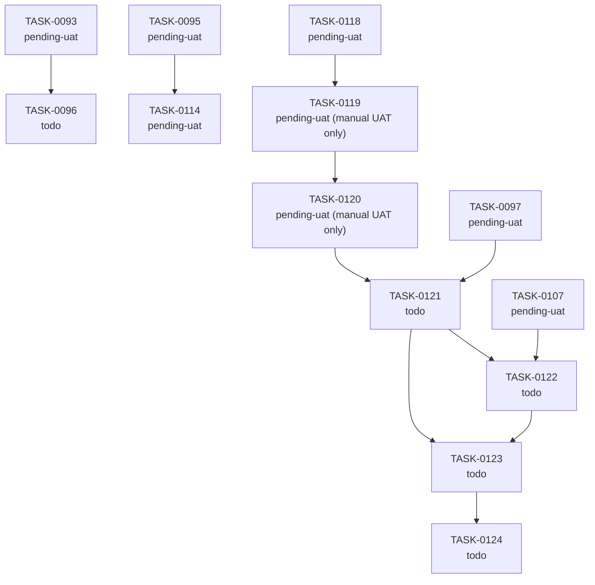

# Task Dependency Graph

> Auto-generated by `/task-audit` on 2026-09-20. Re-run to refresh. Do not edit by hand.
> Only tasks with at least one live edge are drawn; all other active tasks are independent. Edges are read from frontmatter `depends_on` / `blocks`.

## Execution Waves (Parallelism)

| Wave | Tasks | Can run in parallel |
|------|-------|---------------------|
| 1 | TASK-0121, TASK-074, TASK-0096, TASK-0101 | Yes — no shared dependencies (⚠️ 0101 is interactive `/adr-create`; 0119 and 0120 are implemented, awaiting manual UAT; 0097 awaiting UAT) |
| 3 | TASK-0121 | Waits for 0120 (and 0097 UAT) |
| 4 | TASK-0122 | Waits for 0121 (and 0107 UAT) |
| 5 | TASK-0123 | Waits for 0122 |
| 6 | TASK-0124 | Waits for 0123 |

All `pending-uat` tasks are implemented and only await UAT; they are treated as resolved prerequisites for wave purposes.

## Blocking Chains

- 0118 → 0119 → 0120 → 0121 → 0122 → 0123 → 0124 (ROADMAP-0014 Phase 4 — strictly sequential critical path)
- 0097 → 0121, 0107 → 0122 (UAT-gated side inputs)
- 0093 → 0096, 0095 → 0114
